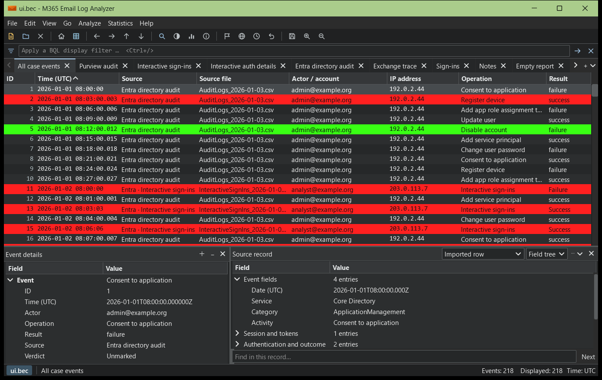

# M365 Email Log Analyzer

<p align="center"></p>

M365 Email Log Analyzer puts every log from a Microsoft 365 email compromise on one UTC timeline. Load Purview audit logs, Entra sign-ins and directory audits, and Exchange message traces, then filter, mark, and export what the attacker did.

It runs offline on Windows and Linux. Nothing leaves your machine.

**Download:** [Windows x64](https://github.com/xss3cut10n3r/M365-BEC/releases/latest/download/M365-BEC-windows-x64.zip) | [Linux x64](https://github.com/xss3cut10n3r/M365-BEC/releases/latest/download/M365-BEC-linux-x64.tar.gz)

## Why use it

- **One timeline.** Portal exports arrive as separate CSV, Excel, and JSON files with different columns. Here they sort together by time.
- **Evidence stays intact.** Each log is copied into a single `.bec` case file and sealed with its SHA-256 hash. Your original files are only read.
- **Fast answers.** Right-click any value to filter on it. Ask who signed in from an IP, what rules a mailbox gained, or where a message went.
- **Verdicts.** Mark events, IPs, or time ranges good, bad, or unsure. Rows are colored across the whole case.
- **Traceable results.** Every event links back to its file and row. Export what you see as CSV, Excel, or JSON.

## Get started

1. Extract the download and run `M365-BEC.exe` (Linux: `./m365-bec`).
2. Click **Open logs** and pick your exports. Save the case when asked.
3. Choose **All case events** in the **View** menu.
4. Right-click an IP address, then **Apply as Filter** > **Selected**.
5. Mark what you find from the **Edit** menu. Export from the **File** menu.

Filters are typed above the timeline:

```text
mailbox = "analyst@example.org" AND operation contains "InboxRule"
```

The **Help** menu lists every field. **Statistics** summarizes IPs, sign-ins, and mailbox activity.

## Command line

```sh
M365-BEC --case case.bec logs.csv signins.json
M365-BEC --case case.bec --filter "ip = 203.0.113.7" --export hits.json
```

Add `--no-gui` to import without opening a window.

## Build from source

C17 with GTK 4, SQLite, and CMake.

Windows, in the [MSYS2](https://www.msys2.org) UCRT64 shell:

```sh
pacman -S --needed mingw-w64-ucrt-x86_64-{gcc,cmake,ninja,pkgconf,gtk4,sqlite,libxlsxwriter,libzip,yyjson,ntldd}
bash packaging/windows.sh
```

Linux, on Ubuntu 24.04 or newer:

```sh
sudo apt install build-essential cmake ninja-build pkg-config libgtk-4-dev libsqlite3-dev zlib1g-dev libexpat1-dev libzip-dev libxlsxwriter-dev
bash packaging/linux.sh
```

Packages are written to `dist/`. Run the tests with `ctest --test-dir build/win --output-on-failure`.

## License

[GPL-3.0](LICENSE)
